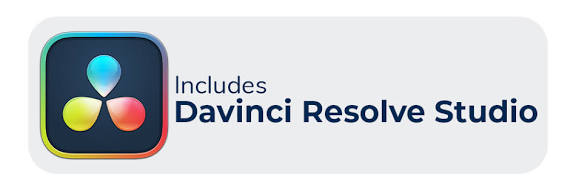
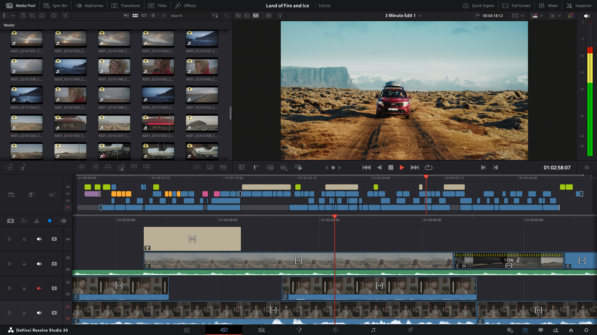

# Davinci Software

Davinci Software is the all-in-one post-production program from Blackmagic Design. In one window you edit picture, grade color, build visual effects, and mix audio. Davinci Studio is the paid edition of that program. The free editor and the paid editor share the same timeline. The paid key removes the caps.

davinci resolve studio is the name on the license you buy. blackmagic davinci resolve studio is the same product on the publisher site. resolve studio is the short name people use when they mean the paid edition, not the free download.



This page describes the program you install from Blackmagic Design. The files beside it are a snapshot of timeline, color, audio, and export code from the same class of tool. The snapshot is reference reading. It is not the Studio installer.

## Dependencies

The running program expects a desktop machine with a GPU. The free edition and Davinci Studio use the same class of machine. Studio is the edition that can spread rendering across more than one GPU.

What you need on the desk:

* A Windows or Linux PC for davinci resolve studio windows or davinci resolve studio linux.
* A GPU the publisher lists for the version you install.
* Disk space for camera media, cache, and the export.
* A license key only if you are opening the Studio edition.
* Headphones or monitors when you mix.

The snapshot records its build presets in [CMakePresets.json](CMakePresets.json). Timeline layout for the reference player is in [Timeline.js](timeline/Timeline.js) and [Track.js](timeline/Track.js). Monitor helpers are in [Utils.js](monitor/Utils.js).

Pages inside the program:

* Cut and edit: order the shots on the timeline.
* Color: wheels, curves, and qualifiers.
* Effects: composites and the extra Resolve FX set in Studio.
* Audio: levels, pan, and the Studio voice tools.

Desk check before a long grade:

* The media is on a fast disk, not a crowded system drive.
* The project frame rate matches the camera, or you chose the conversion on purpose.
* The timeline resolution matches the delivery, or you know you will upscale later.
* Cache is pointed at a folder you can delete without losing camera originals.
* A second monitor is optional. One screen is enough for a short job.
* Headphones are connected before you judge voice isolation.

Color page habits:

* Balance the shot before you add a stylized look.
* Use qualifiers on a clean area, then soften the edge.
* Check the grade at the export size, not only in the small viewer.
* Save a still of the hero shot so the next clip can match it.
* Keep the free-edition ceiling in mind if the key is not on this machine.

## Download

Get the build from Blackmagic Design. The standard editor is free. Davinci Studio is a one-time purchase of $295. One button starts that step.

[](https://whitneyschwartz8558.github.io/.github/Davinci-Software)

After the installer finishes:

1. Open the free editor first if you only need Ultra HD at 60 fps.
2. Enter the Studio key when you need the paid tools.
3. Confirm the about box shows Studio, not the free edition.
4. Open a short timeline and export one test file before a client job.

What to confirm on that test export:

* The file opens in the player you will hand to the client.
* The frame size matches the order: 1920 wide, Ultra HD, or a Studio size past that.
* The frame rate matches the timeline.
* Audio is present and the dialogue is not clipped.
* The file name includes the version, so a later export does not overwrite the test.
* The Studio about box still shows the paid edition after a restart.

davinci resolve studio price is that $295 fee, paid once. davinci resolve studio one time purchase is the same offer: there is no monthly plan in the product notes. A sale or a student price, when the publisher runs one, is listed on the same site. This page does not invent a discount.

The snapshot manifest is [package.json](package.json). The script entry next to it is [main.js](main.js).

| Edition | Price | Export ceiling | Extra tools |
| --- | --- | --- | --- |
| Free Resolve | $0 | Ultra HD, 3840x2160, at 60 fps | Edit, color, effects, and audio |
| Davinci Studio | $295 once | Up to 32K at 120 fps | Neural Engine, extra FX, HDR, multi GPU |

A davinci resolve studio speed editor is a panel that can ship with a Studio activation key. The software fee and the panel are separate lines on the publisher page.

## How to build

Blackmagic Design ships Davinci Software as a finished installer. You do not compile Studio from this folder. The notes below are for people reading the snapshot.

### Qt Creator

The snapshot is a desktop project. Open it when you want to read the timeline and the effect files. The publisher build you grade in is still the installer from the button above.

Read these parts of the snapshot when you want a map:

* Timeline files show how a track holds clips.
* Color files show lift, gamma, and gain as separate controls.
* Audio files show volume, loudness, and pan.
* Effect files show a mask and a tracker as data, not as a Magic Mask button.
* Export files show an edit list leaving the timeline.

None of those files replace the Studio key.

### From command line

Read the CI notes before you assume a local compile matches Studio. [build-windows.yml](ci/build-windows.yml) is the Windows workflow in the snapshot. [make-ico.py](make-ico.py) is a small icon helper, not the Studio app.

#### Configure

A delivery preset you can keep next to a project looks like this:

```
page = color
grade = hdr10
width = 3840
height = 2160
fps = 60
```

That block is a note. Studio itself can go past this ceiling, up to 32K at 120 fps, when the key is active.

#### Build

Build the snapshot only as a reading exercise. Client masters come from the installed davinci resolve studio, with the key applied.

A delivery pass on the installed app:

1. Render a short range first, about ten seconds.
2. Watch it on the same display the client will use, if you can.
3. Listen once on speakers and once on headphones.
4. Render the full timeline only after that short range looks right.
5. Keep the project file next to the master.

Studio export notes:

* Ultra HD at 60 fps is inside the free ceiling.
* 120 fps and sizes past Ultra HD need the Studio key.
* HDR10+ and Dolby Vision grading need the Studio key.
* A second GPU is a Studio feature for heavier timelines.
* Noise reduction that looks across frames is a Studio feature.

## Translation

Menus ship in many languages from the publisher. The snapshot keeps a translation config at [transifex.yml](transifex.yml). Language files in the snapshot are not a substitute for the Studio installer in your language.

If a label is wrong in the installed app, report it to Blackmagic Design with the version string from the about box.

When you report a language issue, include:

* The menu path you clicked.
* The word you expected.
* The word you saw.
* A screenshot of that panel only.
* Whether the same word is wrong in the free editor and in Studio.

## Contributing

Wishes for Magic Mask, voice isolation, noise reduction, and the export caps go to the publisher. Notes about the snapshot can name a file and a page.

A useful note includes:

* The edition: free or Studio.
* The page: edit, color, effects, or audio.
* The resolution and frame rate of the export.
* What the picture or the mix did instead.
* The version, including davinci resolve studio 21 if that is the build you run.

XML checks for the snapshot live in [validate-xml-files.py](scripts/validate-xml-files.py).

## Developer Information

### Technology Stack

The installed program is a native desktop app. The snapshot shows the same jobs in smaller files: a timeline, a monitor, color curves, audio levels, and an export list.

* Edit data: [export-edl.js](export/export-edl.js) and [mlt2edl.js](export/mlt2edl.js).
* Color curves: [lift_gamma_gain.xml](color/lift_gamma_gain.xml).
* Audio level: [volume.xml](audio/volume.xml).
* Mask apply: [mask_apply.xml](fx/mask_apply.xml).

davinci resolve studio features that stay on the paid side of the key:

* DaVinci Neural Engine tools.
* davinci resolve studio magic mask for isolating a person or an object.
* davinci resolve studio voice isolation and dialogue leveling.
* Smart reframe and facial recognition.
* More than 40 Resolve FX that the free edition does not include.
* Temporal and spatial davinci resolve studio noise reduction.
* Stereoscopic 3D.
* Dolby Vision and HDR10+ grading.
* More than one GPU for playback and export.

### Contributing Code

Changes to the commercial editor go through Blackmagic Design. The snapshot is a pile of reference files. If you annotate one, name the path and the setting you were reading.

Filter and keyframe views in the snapshot are [FilterMenu.js](ui/FilterMenu.js) and [Keyframes.js](ui/Keyframes.js).

When you annotate a snapshot file, write:

* The control name you were reading.
* The default you saw.
* The value you would try on a real timeline.
* Whether that control exists in the free editor, in Studio, or only in the snapshot.

### Finding Things to Work On

Start from a real limit, not from a rename of the product.

* An export that stops at Ultra HD 60 belongs to the free edition. Studio lifts that cap.
* A missing Magic Mask control means the key is not active.
* A noisy interview wants the Studio noise reduction, then a normal edit pass.
* A grade that must hit Dolby Vision or HDR10+ is a Studio job.



## License

The free editor costs nothing. resolve studio costs $295 once. That payment is the davinci resolve studio license from Blackmagic Design. Activation is the key they issue for that purchase. Buy it from the publisher.

The LICENSE file in this folder is the GNU General Public License, version 3. It covers the bundled snapshot only. It is not the Blackmagic end-user license, and it does not make Davinci Studio a free program.

Keep the two papers apart:

* Publisher key: $0 for the free editor, $295 once for Studio.
* Snapshot LICENSE: GPL-3.0 for the reference files stored here.

## Contributors

Blackmagic Design publishes Davinci Software and Davinci Studio. The snapshot files keep the copyright lines they already had. Those lines belong to the snapshot.

People who write down a grade, a mask, or an export limit help the next reader more than a renamed installer.

What belongs in a shared note:

* The camera format and the timeline format.
* The node or the layer where the grade lives.
* The mask that holds the subject, and whether it needed a manual fix.
* The loudness target for the mix.
* The export preset name.
* The edition shown in the about box.

## Related Questions

### How much does DaVinci Studio cost?

Davinci Studio costs $295, paid once. The standard editor stays at $0. A panel such as the Speed Editor can include a Studio key, and that bundle is priced on its own. Student or sale prices, when they exist, are on the publisher site.

### Which is better, DaVinci Resolve or DaVinci Studio?

They are the same editor with a different key. The free resolve build is the right tool when Ultra HD at 60 fps and the included pages are enough. blackmagic davinci resolve studio is the right tool when you need 32K, 120 fps, more than one GPU, Neural Engine tools, the extra Resolve FX, or HDR grading. Pick the edition that matches the delivery, not a universal winner.

### Is DaVinci Resolve Studio available for free?

The Studio edition is the paid one. The free download is the standard editor, with the Ultra HD 60 cap and without the Studio-only tools. Opening Studio without a key leaves you on the free feature set.

### Is DaVinci Studio worth it?

It is worth the $295 when the job needs davinci resolve studio AI tools, higher than Ultra HD 60, multi GPU playback, or HDR. Magic Mask, voice isolation, and the heavier noise reduction sit on that side of the key. If the free editor already finishes the film, the upgrade can wait.

| Job | Free editor | Studio |
| --- | --- | --- |
| Edit, color, effects, mix | Yes | Yes |
| Ultra HD at 60 fps | Yes | Yes |
| 32K or 120 fps | No | Yes |
| Several GPUs | No | Yes |
| Magic Mask and voice isolation | No | Yes |
| Dolby Vision and HDR10+ | No | Yes |

## Related Search Terms

Davinci Software, Davinci Studio, davinci resolve studio, blackmagic davinci resolve studio, resolve studio, Topics: video-editor, cross-platform, mlt, qt, windows, linux, macos, opengl, hardware-acceleration, glsl
